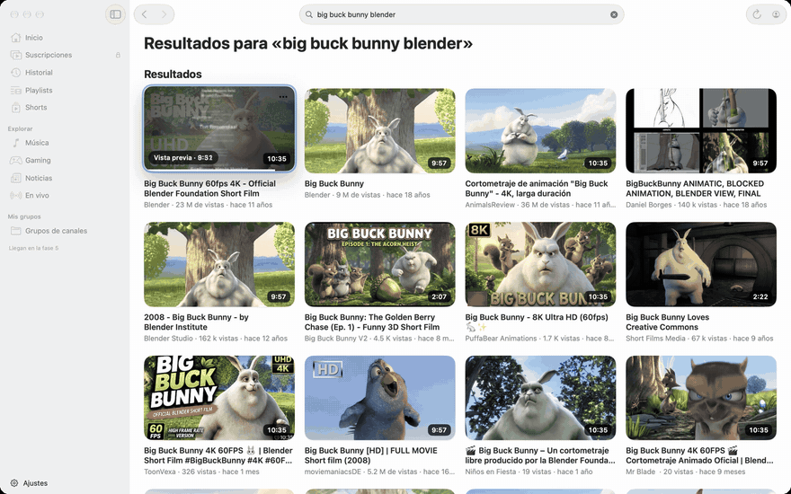

<p align="center"></p>

<h1 align="center">Glasstube</h1>

<p align="center"><b>A native YouTube client for the Mac, in Liquid Glass.</b></p>

<p align="center"><a href="README.md">Español</a> · <b>English</b></p>

<p align="center"></p>

> [!IMPORTANT]
> Glasstube is an independent project. **It is not affiliated with, endorsed by or sponsored by YouTube or Google.**
> It is not an official SmartTube project either. "YouTube" is a trademark of Google LLC. Please read the
> [FAQ](#faq) before using it with your account.

Glasstube brings **SmartTube**, the free YouTube client for Android TV (MIT licence), to macOS as a native app written
in Swift and SwiftUI with the Liquid Glass design of macOS 26. No ads, no tracking, and playback through libmpv on
Metal. It builds with SwiftPM and the Command Line Tools, **no Xcode required**.

It was built with [Claude Code](https://claude.com/claude-code), and the prompt that has Claude Code walk you through
the build is in the repository: [PROMPT.md](PROMPT.md).

The app's interface is in Spanish for now.

| | |
|---|---|
|  |  |
|  |  |

<sub>Screenshots show *Big Buck Bunny* © Blender Foundation, [CC BY 3.0](https://creativecommons.org/licenses/by/3.0/).
Commenters appear as @persona1, @persona2…, and the pairing code is a test code.</sub>

- [How it works](#how-it-works)
- [Download](#download)
- [Quick start](#quick-start)
- [What you get](#what-you-get)
- [Requirements](#requirements)
- [Building by hand](#building-by-hand)
- [Troubleshooting](#troubleshooting)
- [FAQ](#faq)
- [Contributing](#contributing)
- [Licence and credits](#licence-and-credits)

---

## How it works

1. **It asks for the video the way the TV app does.** YTKit talks to YouTube's internal API (InnerTube) as the YouTube
   app for TVs, just like SmartTube, and rotates to another client if one fails. Sign-in works like on a TV too: you
   type a code at youtube.com/activate, and Glasstube never sees your password.
2. **It solves the challenges with JavaScriptCore and a PoToken.** YouTube protects each stream's signature and `n`
   parameter with JavaScript functions that change with every player release. Glasstube solves them with the
   [yt-dlp/ejs](https://github.com/yt-dlp/ejs) solver running in JavaScriptCore. The PoToken, BotGuard's anti-bot
   proof, is minted in an invisible WKWebView.
3. **It streams over SABR and plays with libmpv on Metal.** Video arrives over SABR, the adaptive streaming protocol
   YouTube's own apps use, and libmpv (mpv and FFmpeg, LGPL) plays it, rendering on Metal with VideoToolbox hardware
   decoding. Live streams go through HLS and AVPlayer.

The code is split into three Swift packages:

| Package | What it does |
|---|---|
| [YTKit](YTKit/) | Talks to YouTube: catalogue, search, accounts, streams, SABR, comments, chat, remote control. No UI. Includes the `ytkit` command-line tool. |
| [PlaybackKit](PlaybackKit/) | The playback engine: libmpv (dynamic and replaceable), AVPlayer for live streams, and the SABR source. |
| [App](App/) | The SwiftUI app: windows, Liquid Glass, settings and macOS integration. |

---

## Download

Get **`Glasstube-<version>.dmg`** from [Releases](https://github.com/werwill/glasstube/releases/latest). It is a
**preview**: it works, but YouTube changes its player often and something may break until the next version (the app
tells you when one is out).

- **Requirements:** macOS 26 Tahoe or later on an Apple silicon Mac (M1 or later). It does not run on Intel Macs.
- **Install:** open the `.dmg` and drag Glasstube to **Applications**.
- **Check the download** (optional): `shasum -a 256 ~/Downloads/Glasstube-<version>.dmg` must match the SHA-256 in the
  release notes.

**The first time you open it.** While releases are not notarised by Apple, macOS blocks the app the first time you open
it. Each release's notes say whether it is notarised; if it is, it opens straight away. If not:

1. Open Glasstube from Applications. macOS says it can't verify that it is free of malware: click **Done** (not "Move to
   Trash").
2. Go to **System Settings › Privacy & Security**, scroll down to **Security** and click **Open Anyway** next to
   "Glasstube" was blocked….
3. Confirm with your password or Touch ID and click **Open**. It won't ask again until the next version.

If you sign in to YouTube, macOS also asks whether Glasstube may use the Keychain: choose **Always Allow**.

### New-version notice

When it opens, and at most once a day, Glasstube asks GitHub for the latest published release
(`api.github.com/repos/werwill/glasstube/releases/latest`). If there is a newer one, a glass notice appears in the
bottom-right corner with **Descargar** (Download), which opens that release's page in your browser, and **Ahora no**
(Not now), which hides it until the next check. Nothing is installed automatically: to update, download the new `.dmg`
and replace the app in Applications. Your settings, history and session stay.

It is the only request the app makes on its own, and it carries no data about you or what you watch. Turn it off in
**Ajustes › General › Actualizaciones** (Settings › General › Updates), where there is also a "check now" button. A copy
you build yourself checks the same repository; `GITHUB_REPO= App/Scripts/package-app.sh` builds one without the notice.

---

## Quick start

To build it yourself you need an Apple silicon Mac on macOS 26 or later, the Command Line Tools (`xcode-select --install`) and
[Claude Code](https://claude.com/claude-code) or a similar assistant.

1. **Clone the repository:**
   ```bash
   git clone https://github.com/werwill/glasstube.git
   cd glasstube
   ```
2. **Open Claude Code in that folder** and ask it to "follow the instructions in PROMPT.md".
3. **Follow along.** It checks the requirements, downloads and links libmpv, explains how to create your code-signing
   certificate (you do that step yourself), packages the app, generates the icon and opens it. If macOS blocks the
   app, it tells you what to do.

Rather do it yourself? Everything is in [Building by hand](#building-by-hand).

---

## What you get

- **Browsing:** Home, Subscriptions, History, Playlists and Explore (Music, Gaming, News, Live). Search with
  suggestions, channels with their tabs, and a preview when you hover over a thumbnail.
- **Player:** up to 2160p60 with VP9, AV1 (hardware-decoded from the M3 on) and H.264. Quality, speed, subtitles and
  audio track. Chapters and storyboard thumbnails on the scrubber. It resumes where you left off.
- **Side panel:** description, chapters, comments with replies, live chat and suggestions. There is also a floating
  mini player and a queue with autoplay.
- **Community:** [SponsorBlock](https://sponsor.ajay.app) to skip sponsors, [DeArrow](https://dearrow.ajay.app) for
  less clickbaity titles and thumbnails, and [Return YouTube Dislike](https://returnyoutubedislike.com).
- **Your account:** sign in with a code, like on a TV. Multiple accounts and brand accounts, likes, subscriptions,
  playlists and Watch Later. Sessions are stored in the Keychain.
- **Control from your phone:** pair the YouTube app on your phone with a TV code or a QR code, then pick videos,
  pause, seek and change the volume or subtitles from it.
- **macOS:** `glasstube://` links, paste (⌘V) or drop YouTube links, "Abrir en Glasstube" in the Services menu,
  Spotlight, a Dock menu, Now Playing and media keys. YouTube-style shortcuts (K, J/L, F, C, M, 0–9) and light or dark
  appearance.

**Not there yet:** channel groups, a Shorts feed, search filters, settings backup and a TV mode. Widgets, Shortcuts
and a share extension need Xcode and are out of scope for now.

---

## Requirements

- **macOS 26 Tahoe or later.** Tested on macOS 27.
- **Apple silicon** (M1 or later). libmpv is only built for arm64, so Intel Macs are not supported.
- **Swift 6.4 from the Command Line Tools:** `xcode-select --install`. Xcode is not needed.
- **About 4 GB of free space** for the MPVKit downloads (~330 MB) and the builds of the three packages.
- **An internet connection** for the first MPVKit download from GitHub.
- **Optional:** your own code-signing certificate, so the Keychain stops asking for permission after every build. See
  [below](#the-keychain-asks-for-permission-after-every-build).

---

## Building by hand

```bash
git clone https://github.com/werwill/glasstube.git
cd glasstube
PlaybackKit/Scripts/fetch-libmpv.sh   # downloads MPVKit's LGPL binaries and checks every SHA-256
PlaybackKit/Scripts/link-libmpv.sh    # links them into PlaybackKit/Vendor/Libmpv.xcframework
App/Scripts/make-icon.sh              # optional: rebuilds App/Icon/AppIcon.icns from the SVG
App/Scripts/package-app.sh            # release build, assembled into App/build/Glasstube.app
open App/build/Glasstube.app
```

`package-app.sh` signs the app with your "Glasstube Desarrollo" certificate if it finds one, and ad hoc otherwise.
Other options:

| Command | What it does |
|---|---|
| `OPEN=1 App/Scripts/package-app.sh` | package and open the app |
| `CONFIG=debug App/Scripts/package-app.sh` | faster debug build |
| `SIGN_IDENTITY=- App/Scripts/package-app.sh` | sign ad hoc even if the certificate exists |
| `SIGN_IDENTITY="Some name" App/Scripts/package-app.sh` | sign with a different code-signing identity |

**A release for download** (for whoever publishes): `App/Scripts/release.sh 0.5.0` sets that version, builds, packages
and leaves the `.dmg` (with the Applications shortcut), its SHA-256 and the release notes in `dist/`. It uploads
nothing. If the Keychain holds a "Developer ID Application" certificate and a `notarytool` profile, it signs with the
hardened runtime, notarises and staples the `.dmg`. Details in [App/NOTAS.md](App/NOTAS.md#distribución) (Spanish).

**Tests** (each package on its own):

```bash
(cd YTKit && swift test)
(cd PlaybackKit && swift test)
(cd App && swift test)
```

**The `ytkit` tool** shows what YouTube returns without opening the app:

```bash
cd YTKit
swift run ytkit search "big buck bunny"
swift run ytkit next aqz-KE-bpKQ
```

**Screenshots:** `App/Scripts/capturas-readme.sh` rebuilds the ones on this page and the GIF (it needs ffmpeg), and
`App/Scripts/capturas.sh` rebuilds the development ones. Both need the Screen Recording permission.

Each package has technical notes, in Spanish: [YTKit/NOTAS.md](YTKit/NOTAS.md),
[PlaybackKit/NOTAS.md](PlaybackKit/NOTAS.md) and [App/NOTAS.md](App/NOTAS.md).

---

## Troubleshooting

### Opening the app

- **"Glasstube can't be opened because Apple cannot check it for malicious software."** This happens when the app
  came from another Mac, AirDrop or an unnotarised download, because it carries the quarantine flag (see
  [Download](#download)). Try to open it once, then go to
  **System Settings › Privacy & Security**. Near the bottom you'll see that "Glasstube" was blocked: click **Open
  Anyway** and confirm with your password or Touch ID. An app you built on your own Mac has no quarantine flag and
  opens straight away.
- **It stays on "Cargando…" (Loading) at launch.** macOS is probably waiting for you to answer the Keychain prompt,
  which sometimes hides behind other windows. Find it and choose **Always Allow**.

### The Keychain asks for permission after every build

Glasstube keeps your sessions in the Keychain, in the `mx.glasstube.cuentas` item. With ad hoc signing, macOS
identifies the app by the hash of its binary, which changes with every build, so the Keychain asks again. The fix is
to sign with your own certificate, which stays the same across builds:

1. Open **Keychain Access** (⌘ Space, "Keychain Access").
2. Choose **Keychain Access › Certificate Assistant › Create a Certificate…**
3. **Name:** `Glasstube Desarrollo`. **Identity Type:** Self-Signed Root. **Certificate Type:** Code Signing.
4. Click **Create**, then **Done**. Leave the certificate's trust settings alone; they are not needed.
5. Run `App/Scripts/package-app.sh` again. It should say "Firma con …" instead of "Firma ad hoc".

The first time, macOS asks whether `codesign` may use the key and, when the app opens, whether it may read the
Keychain. Choose **Always Allow** both times and it won't ask again. To check that the certificate is there, run
`security find-identity -p codesigning`. Seeing it marked `CSSMERR_TP_NOT_TRUSTED` is normal.

### Building

- **"Falta …/Libmpv.framework" (Libmpv.framework is missing).** Run `PlaybackKit/Scripts/fetch-libmpv.sh`, then
  `link-libmpv.sh`.
- **"SHA-256 de … no coincide" (checksum mismatch).** The download was incomplete or the file changed on GitHub. The
  script deletes that zip, so run it again. If it keeps failing, open an issue rather than editing the checksum.
- **ffprobe or ffmpeg says "Bad CPU type in executable".** Some packages, such as `ffprobe-static` on npm, ship an
  Intel (x86_64) binary even when the folder says arm64, and it won't run without Rosetta. Glasstube doesn't use them
  to build or to play video; only `capturas-readme.sh` uses ffmpeg for the GIF. Check with `file "$(which ffprobe)"`
  and install an arm64 build (with Homebrew, for example) or Rosetta (`softwareupdate --install-rosetta`). Scripts that
  use it accept a path: `FFMPEG=/path/to/ffmpeg App/Scripts/capturas-readme.sh`.

### Playing video

- **"Inicia sesión para confirmar que no eres un bot" (Sign in to confirm you're not a bot).** YouTube sometimes asks
  this of people watching without an account. Glasstube retries on its own with a fresh visitor and PoToken. If the
  message stays, sign in or wait a while.
- **One video won't load but others do.** It may be age-, region- or rights-restricted. The message shows the reason
  YouTube gives.
- **Everything stopped working at once.** Most likely YouTube changed something. See
  [the question below](#why-does-it-sometimes-stop-working).

---

## FAQ

**Can my account get suspended for using it?**
Using an unofficial client goes against YouTube's Terms of Service, so the risk is real and can't be ruled out.
Glasstube signs in the same way a TV does (a code at youtube.com/activate), never sees your password, and you can
revoke its access at any time from your Google account. The app doesn't save videos for offline viewing and doesn't
play protected paid content. If you're worried, use it signed out or with a secondary account.

**Why does it sometimes stop working?**
YouTube changes its player, clients and anti-bot defences often and without notice. When that happens, the yt-dlp/ejs
solver, the client versions in `YTKit/Sources/YTKit/Resources/clients.json`, or the SABR or PoToken code need an
update. SmartTube and yt-dlp go through the same thing. If you notice it, open an issue with the output of
`swift run ytkit sabr-player <videoId> -v`.

**Does Glasstube collect any data?**
No. There are no analytics and no server of its own: the app talks to YouTube directly from your Mac. Your sessions
live in the Keychain, and local history and settings stay on your Mac. SponsorBlock and DeArrow are queried with a
prefix of the video's hash, without sending its ID. Return YouTube Dislike does receive the video ID. All three can
be turned off in Settings.

**What are SponsorBlock, DeArrow and Return YouTube Dislike?**
They are community projects. [SponsorBlock](https://sponsor.ajay.app) marks segments such as sponsors, intros or
reminders so you can skip them. [DeArrow](https://dearrow.ajay.app), by the same authors, replaces sensational titles
and thumbnails with ones people vote on. [Return YouTube Dislike](https://returnyoutubedislike.com) estimates the
dislike count YouTube hid in 2021. Glasstube only queries their public APIs.

**Why isn't the download notarised?**
Notarisation needs a paid Apple developer account. Until there is one, the builds on
[Releases](https://github.com/werwill/glasstube/releases) are not notarised and macOS asks you to confirm them once (see
[Download](#download)); the release script is ready to notarise. If you'd rather not trust someone else's binary, build
it yourself: it takes a few minutes and Claude Code walks you through it. The `.dmg` ships mpv and FFmpeg (LGPL) as a
replaceable dynamic library, and each release's notes link to their source code.

**Does it work on an Intel Mac or on macOS 15?**
No. libmpv is only built for Apple silicon, and the interface uses Liquid Glass, which arrived with macOS 26.

**Why no Xcode?**
So that the Command Line Tools are enough. The trade-off is no widgets, Shortcuts or share extension, which need
Xcode's build system. The Services menu covers "open this link in Glasstube" from any app.

---

## Contributing

Issues and pull requests are welcome. Before sending one:

- Run `swift build` and `swift test` in the packages you touched.
- **Don't commit personal data.** Fixtures that need an account are recorded with `ytkit record-account`, which
  anonymises them, and `FixturePrivacyTests` checks that no token, email or account ID is left. Never commit the raw
  responses.
- **Screenshots use Creative Commons content only** (`App/Scripts/capturas-readme.sh` uses Big Buck Bunny), with no
  signed-in session and no creators' faces.
- Don't commit binaries: `fetch-libmpv.sh` and `link-libmpv.sh` regenerate libmpv.
- Code comments and notes are in Spanish, like the rest of the project.

---

## Licence and credits

Glasstube is released under the [MIT licence](LICENSE), © 2026 werwill.

It exists thanks to:

- [SmartTube](https://github.com/yuliskov/SmartTube) by yuliskov (MIT): the logic Glasstube ports to Swift.
- [yt-dlp/ejs](https://github.com/yt-dlp/ejs) (Unlicense), with [meriyah](https://github.com/meriyah/meriyah) (ISC) and
  [astring](https://github.com/davidbonnet/astring) (MIT).
- [mpv](https://mpv.io) and [FFmpeg](https://ffmpeg.org) (LGPL), through the [MPVKit](https://github.com/mpvkit/MPVKit)
  binaries.
- [SponsorBlock and DeArrow](https://sponsor.ajay.app) and [Return YouTube Dislike](https://returnyoutubedislike.com).
- *Big Buck Bunny* by the [Blender Foundation](https://peach.blender.org) (CC BY 3.0), in the screenshots.

Licence details for each component are in [THIRD-PARTY-NOTICES.md](THIRD-PARTY-NOTICES.md).
