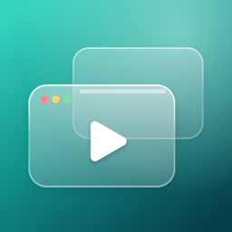
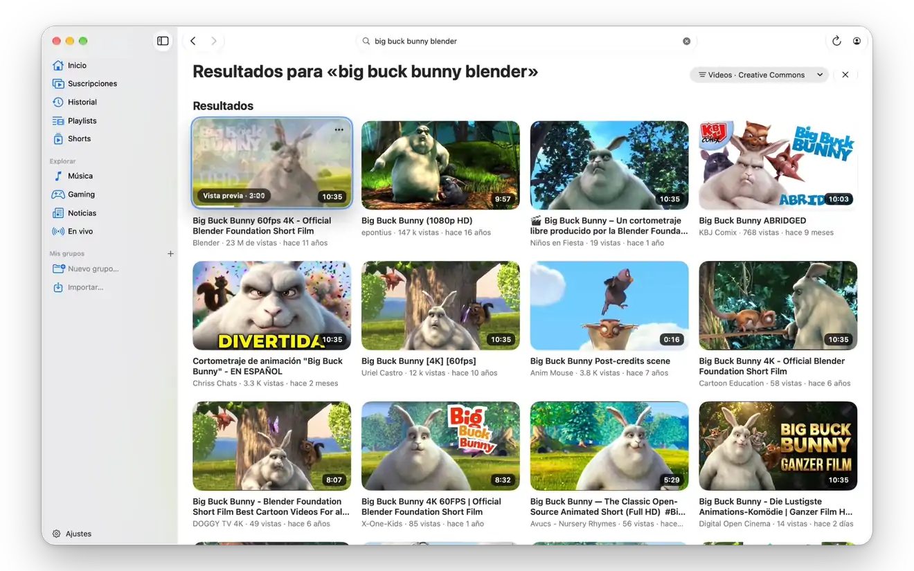
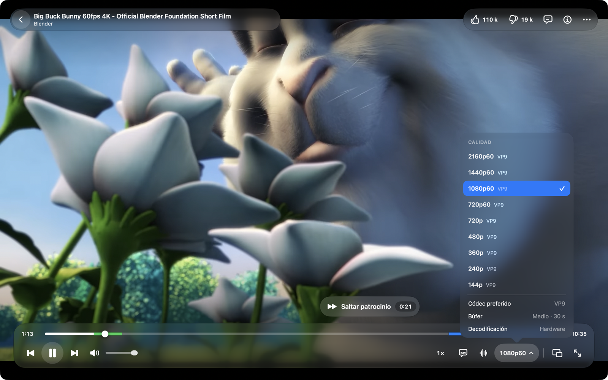
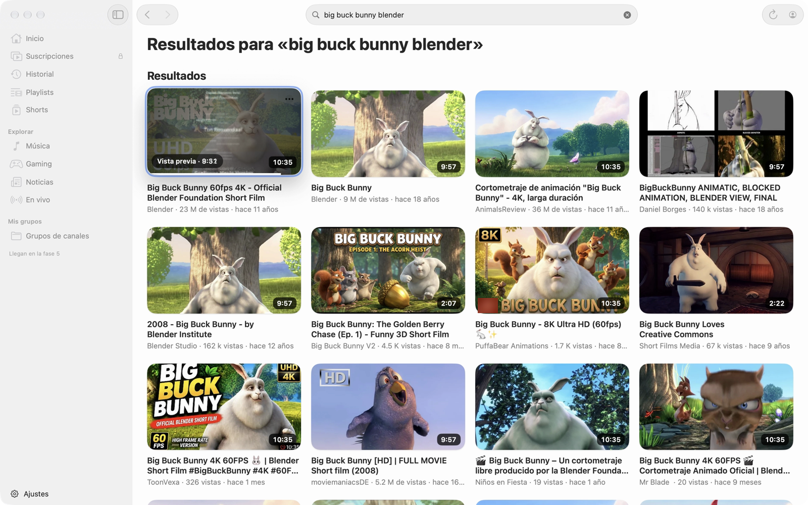
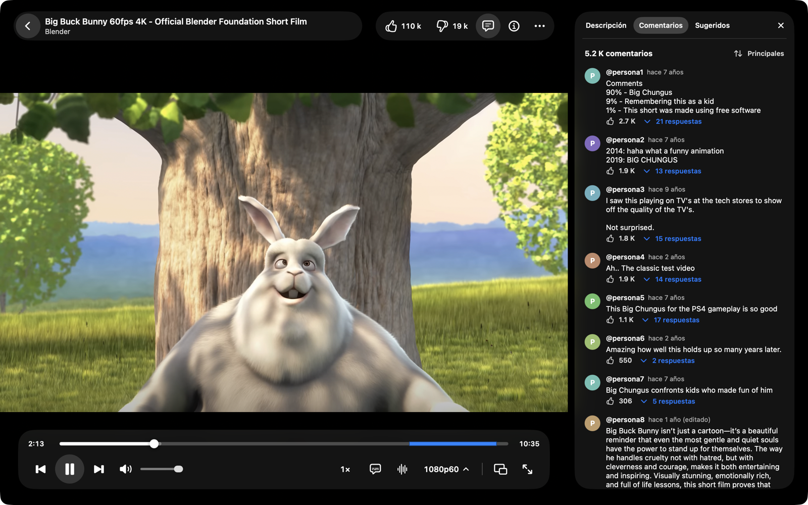
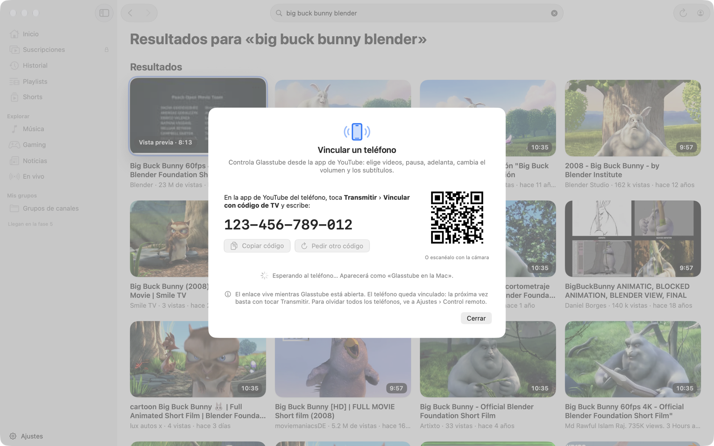
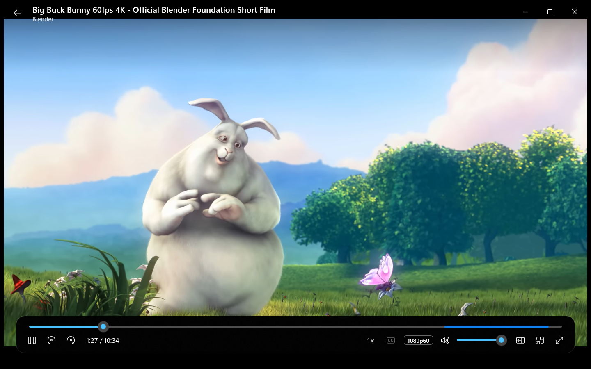
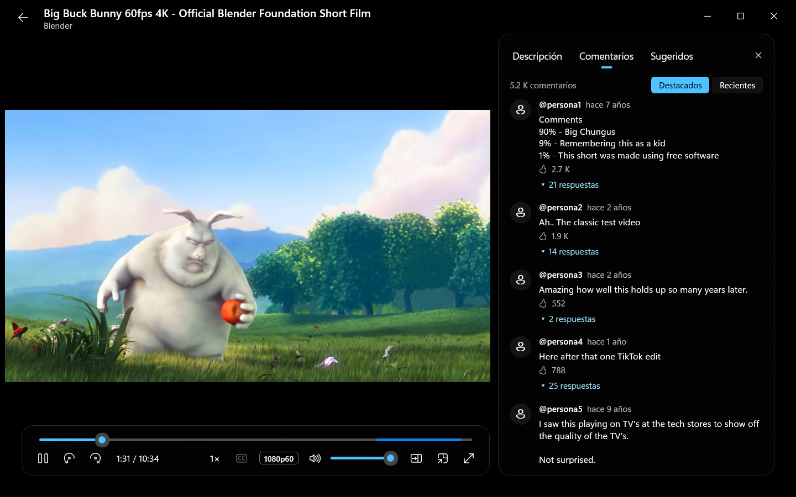
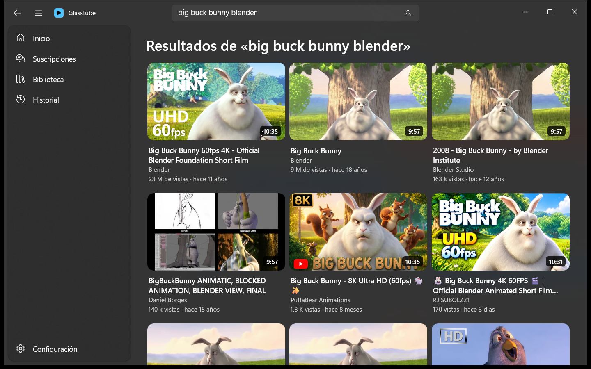

<p align="center"></p>

<h1 align="center">Glasstube</h1>

<p align="center"><b>Un cliente nativo de YouTube para Mac, en Liquid Glass. Y ahora también para Windows.</b></p>

<p align="center"><b>Español</b> · <a href="README.en.md">English</a></p>

<p align="center">
  <a href="https://github.com/werwill/glasstube/releases/latest"></a>
  <a href="https://github.com/werwill/glasstube/releases/tag/windows-v0.2.0"></a>
  <a href="https://github.com/werwill/glasstube/releases/latest"></a>
</p>

<p align="center"><sub>macOS 26 o posterior · Apple Silicon · vista previa · <a href="#descargar">cómo abrirla la primera vez</a><br>
Windows 10 (1809) u 11 · x64 · primera vista previa · <a href="#windows">instalarla</a></sub></p>

<p align="center"></p>

> [!IMPORTANT]
> Glasstube es un proyecto independiente. **No está afiliado a YouTube ni a Google, ni lo respaldan.** Tampoco es un
> proyecto oficial de SmartTube. «YouTube» es una marca de Google LLC. Lee las [preguntas frecuentes](#preguntas-frecuentes)
> antes de usarlo con tu cuenta.

Glasstube porta a macOS **SmartTube**, el cliente libre de YouTube para Android TV (licencia MIT), como una app nativa
en Swift y SwiftUI con el diseño Liquid Glass de macOS 26. No tiene anuncios ni rastreo, y reproduce con libmpv sobre
Metal. Se compila con SwiftPM y las Command Line Tools, **sin Xcode**.

La **versión para Windows** comparte con la de Mac todo lo que habla con YouTube (YTKit) y el motor de libmpv, con una
interfaz propia en WinUI 3 y el acabado de vidrio de Windows 11. Va un paso atrás: ver [Windows](#windows).

Se hizo con [Claude Code](https://claude.com/claude-code). El prompt para que Claude Code te guíe al compilarla viene en
el repositorio: [PROMPT.md](PROMPT.md).

| | |
|---|---|
|  |  |
|  |  |

<sub>En las capturas: *Big Buck Bunny* © Blender Foundation, [CC BY 3.0](https://creativecommons.org/licenses/by/3.0/).
Quienes comentan aparecen como @persona1, @persona2…, y el código de vinculación es de prueba.</sub>

- [Cómo funciona](#cómo-funciona)
- [Descargar](#descargar)
- [Inicio rápido](#inicio-rápido)
- [Qué incluye](#qué-incluye)
- [Requisitos](#requisitos)
- [Compilar a mano](#compilar-a-mano)
- [Solución de problemas](#solución-de-problemas)
- [Preguntas frecuentes](#preguntas-frecuentes)
- [Contribuir](#contribuir)
- [Licencia y créditos](#licencia-y-créditos)

---

## Cómo funciona

1. **Pide el video como la app de TV.** YTKit habla con la API interna de YouTube (InnerTube) presentándose como la app
   de YouTube para televisores, igual que SmartTube. Si un cliente falla, rota al siguiente. El inicio de sesión también
   es el de la tele: un código que escribes en youtube.com/activate. Glasstube nunca ve tu contraseña.
2. **Resuelve los desafíos con JavaScriptCore y el PoToken.** YouTube protege la firma y el parámetro `n` de cada
   stream con funciones de JavaScript que cambian con cada versión de su reproductor. Glasstube las resuelve con el
   solver de [yt-dlp/ejs](https://github.com/yt-dlp/ejs) dentro de JavaScriptCore. El PoToken, la prueba antibots de
   BotGuard, lo genera un WKWebView invisible.
3. **Recibe por SABR y reproduce con libmpv sobre Metal.** El video llega por SABR, el streaming adaptativo que usan las
   apps de YouTube, y lo reproduce libmpv (mpv y FFmpeg, LGPL). Dibuja en Metal y decodifica por hardware con
   VideoToolbox. Los directos van por HLS con AVPlayer.

El código está en tres paquetes de Swift:

| Paquete | Qué hace |
|---|---|
| [YTKit](YTKit/) | Habla con YouTube: catálogo, búsqueda, cuentas, streams, SABR, comentarios, chat, control remoto. Sin interfaz. Trae la herramienta de terminal `ytkit`. |
| [PlaybackKit](PlaybackKit/) | El motor de reproducción: libmpv (dinámica y reemplazable), AVPlayer para directos y la fuente SABR. |
| [App](App/) | La app SwiftUI: ventanas, Liquid Glass, ajustes e integración con macOS. |
| [Windows](Windows/) | La app de Windows: interfaz WinUI 3 (C#), YTKit como DLL y libmpv. Ver [README-WINDOWS.md](Windows/README-WINDOWS.md). |

---

## Descargar

### Mac

Baja **`Glasstube-<versión>.dmg`** de [Releases](https://github.com/werwill/glasstube/releases/latest). Es una **vista
previa**: funciona, pero YouTube cambia seguido su reproductor y a veces algo deja de andar hasta la siguiente versión
(la app te avisa cuando sale una).

- **Requisitos:** macOS 26 Tahoe o posterior y una Mac con Apple Silicon (M1 o posterior). No funciona en Mac con Intel.
- **Instalar:** abre el `.dmg` y arrastra Glasstube a **Applications** (Aplicaciones).
- **Comprobar la descarga** (opcional): `shasum -a 256 ~/Downloads/Glasstube-<versión>.dmg` debe dar la suma SHA-256 que
  publican las notas de la versión.

**La primera vez que la abres.** Mientras las versiones no estén notarizadas por Apple, macOS bloquea la app al abrirla
por primera vez. Las notas de cada versión dicen si viene notarizada; si lo está, se abre directo. Si no:

1. Abre Glasstube desde Aplicaciones. macOS dice que no puede verificar que esté libre de malware: pulsa **Listo** (no
   «Trasladar a la Papelera»).
2. Ve a **Ajustes del Sistema › Privacidad y seguridad**, baja hasta **Seguridad** y, junto a «Se bloqueó
   "Glasstube"…», pulsa **Abrir de todos modos**.
3. Confirma con tu contraseña o Touch ID y pulsa **Abrir**. No vuelve a preguntar hasta la siguiente versión.

Si inicias sesión en YouTube, macOS también pregunta si Glasstube puede usar el Llavero: elige **Permitir siempre**.

### Aviso de versiones nuevas

Al abrirse, y como mucho una vez al día, Glasstube pregunta a GitHub cuál es la última versión publicada
(`api.github.com/repos/werwill/glasstube/releases/latest`). Si hay una más nueva que la tuya, aparece un aviso de
vidrio abajo a la derecha con **Descargar**, que abre la página de esa versión en el navegador, y **Ahora no**, que lo
cierra hasta la siguiente consulta. No instala nada por su cuenta: para actualizar, baja el `.dmg` nuevo y reemplaza la
app en Aplicaciones. Tus ajustes, tu historial y tu sesión se quedan.

Es la única consulta que la app hace por su cuenta, y no lleva datos tuyos ni de lo que ves. Se apaga en **Ajustes ›
General › Actualizaciones**, donde también está «Buscar ahora». Una copia que compilas tú consulta el mismo repositorio;
`GITHUB_REPO= App/Scripts/package-app.sh` arma una sin aviso.

### Windows

| | | |
|---|---|---|
|  |  |  |

<sub>En las capturas: *Big Buck Bunny* © Blender Foundation, [CC BY 3.0](https://creativecommons.org/licenses/by/3.0/).
Quienes comentan aparecen como @persona1, @persona2…</sub>

Baja **`Glasstube-<versión>-Windows-x64-Setup.exe`** de su [versión en Releases](https://github.com/werwill/glasstube/releases/tag/windows-v0.2.0). Las de Windows van aparte,
con etiquetas `windows-v…`, y no se marcan como la última: así el aviso de la app de Mac no las toma por suyas.

- **Requisitos:** Windows 10 1809 o posterior, u 11, de 64 bits (x64). Necesita Microsoft Edge WebView2, que Windows 11
  ya trae; si falta, el instalador lo avisa.
- **Instalar:** abre el `.exe`. Se instala para tu usuario sin pedir permisos de administrador, con acceso en el menú
  Inicio y desinstalador en Configuración › Aplicaciones. No hace falta instalar .NET ni nada más.
- **La primera vez:** el instalador no está firmado, así que SmartScreen dice que «Windows protegió su PC». Pulsa **Más
  información** y luego **Ejecutar de todas formas**.
- **Comprobar la descarga** (opcional): `Get-FileHash Glasstube-<versión>-Windows-x64-Setup.exe` en PowerShell debe dar
  la suma SHA-256 de las notas de la versión.

Ya tiene Inicio, Suscripciones, Historial, Biblioteca (Ver más tarde y tus listas), páginas de canal y el reproductor
con calidad, subtítulos, capítulos, SponsorBlock, comentarios, sugeridos y los botones de suscribirte, me gusta y no me
gusta (con Return YouTube Dislike). Se actualiza sola: avisa de cada versión nueva y la instala con un clic. Inicias sesión
desde el botón de cuenta, con un código como en la tele. Todavía no hay ajustes. Lo que falta, cómo compilarla y cómo arma el instalador están en [Windows/README-WINDOWS.md](Windows/README-WINDOWS.md).

---

## Inicio rápido

Para compilarla tú necesitas una Mac con Apple Silicon, macOS 26 o posterior, las Command Line Tools
(`xcode-select --install`) y [Claude Code](https://claude.com/claude-code) o un asistente parecido.

1. **Clona el repositorio:**
   ```bash
   git clone https://github.com/werwill/glasstube.git
   cd glasstube
   ```
2. **Abre Claude Code en esa carpeta** y pídele: «Sigue las instrucciones de PROMPT.md».
3. **Sigue sus pasos.** Revisa los requisitos, descarga y enlaza libmpv, te explica cómo crear tu certificado de firma
   (ese paso lo haces tú), empaqueta la app, genera el ícono y la abre. Si macOS la bloquea, te dice qué hacer.

¿Prefieres hacerlo tú? Está todo en [Compilar a mano](#compilar-a-mano).

---

## Qué incluye

Lo que sigue es la app de Mac; la de Windows tiene una parte (ver [Windows](#windows)).

- **Navegación:** Inicio, Suscripciones, Historial, Playlists, Shorts y Explorar (Música, Gaming, Noticias, En vivo).
  Búsqueda con sugerencias y filtros (prioridad, fecha, tipo, duración, Creative Commons…), canales con sus pestañas y
  vista previa al pasar el puntero sobre una miniatura.
- **Organizar:** grupos de canales en la barra lateral, cada uno con el feed de lo nuevo de sus canales (por RSS, con o
  sin cuenta). Se importan de PocketTube, GrayJay y NewPipe. Sin cuenta, te suscribes en la Mac y Suscripciones junta
  sus videos. Los canales bloqueados desaparecen de todos los feeds y de la búsqueda.
- **Reproductor:** hasta 2160p60, con VP9, AV1 (por hardware desde el M3) y H.264. Calidad, velocidad, subtítulos y
  pista de audio. Capítulos y la miniatura del storyboard en la barra. Retoma donde lo dejaste.
- **Panel lateral:** descripción, capítulos, comentarios con respuestas, chat de los directos y sugeridos. También hay
  minirreproductor flotante y una cola con reproducción automática.
- **Comunidad:** [SponsorBlock](https://sponsor.ajay.app) para saltar patrocinios, [DeArrow](https://dearrow.ajay.app)
  para títulos y miniaturas sin clickbait, y [Return YouTube Dislike](https://returnyoutubedislike.com).
- **Tu cuenta:** inicio de sesión por código, como en la tele. Varias cuentas y cuentas de marca, me gusta,
  suscripciones, playlists y Ver más tarde. Las sesiones se guardan en el Llavero.
- **Control desde el teléfono:** vinculas la app de YouTube del teléfono con un código de TV o un QR. Desde ahí eliges
  videos, pausas, adelantas y cambias el volumen o los subtítulos.
- **macOS:** enlaces `glasstube://`, pegar (⌘V) o soltar enlaces de YouTube, «Abrir en Glasstube» en el menú
  Servicios, Spotlight, menú del Dock, «Ahora suena» y teclas multimedia. Atajos como los de YouTube (K, J/L, F, C, M,
  0–9) y apariencia clara u oscura.

**Todavía no hay:** respaldo de ajustes, actualización automática ni modo TV (llegan en la fase 5b). Los widgets, Atajos
y la extensión de compartir necesitan Xcode y por ahora quedan fuera.

---

## Requisitos

- **macOS 26 Tahoe o posterior.** Se probó en macOS 27.
- **Apple Silicon** (M1 o posterior). libmpv se arma solo para arm64; no funciona en Mac con Intel.
- **Swift 6.4 de las Command Line Tools:** `xcode-select --install`. No hace falta Xcode.
- **Unos 4 GB libres:** las descargas de MPVKit (~330 MB) y las compilaciones de los tres paquetes.
- **Conexión a internet** para la primera descarga de MPVKit desde GitHub.
- **Opcional:** un certificado propio de firma de código, para que el Llavero no te pida permiso en cada compilación.
  Ver [abajo](#el-llavero-pide-permiso-cada-vez-que-compilo).

---

## Compilar a mano

```bash
git clone https://github.com/werwill/glasstube.git
cd glasstube
PlaybackKit/Scripts/fetch-libmpv.sh   # descarga los binarios LGPL de MPVKit y verifica cada SHA-256
PlaybackKit/Scripts/link-libmpv.sh    # los une en PlaybackKit/Vendor/Libmpv.xcframework
App/Scripts/make-icon.sh              # opcional: rehace App/Icon/AppIcon.icns desde el SVG
App/Scripts/package-app.sh            # compila en release y arma App/build/Glasstube.app
open App/build/Glasstube.app
```

`package-app.sh` firma la app con tu certificado «Glasstube Desarrollo» si lo encuentra y, si no, la firma ad hoc.
Otras opciones:

| Comando | Qué hace |
|---|---|
| `OPEN=1 App/Scripts/package-app.sh` | empaqueta y abre la app |
| `CONFIG=debug App/Scripts/package-app.sh` | compilación de depuración, más rápida |
| `SIGN_IDENTITY=- App/Scripts/package-app.sh` | firma ad hoc aunque tengas el certificado |
| `SIGN_IDENTITY="Otro nombre" App/Scripts/package-app.sh` | firma con otra identidad de firma de código |

**Una versión para descargar** (para quien publica): `App/Scripts/release.sh 0.5.0` pone esa versión, compila, empaqueta
y deja en `dist/` el `.dmg` (con el acceso a Aplicaciones), su SHA-256 y las notas para GitHub Releases. No sube nada.
Si en el Llavero hay un certificado «Developer ID Application» y un perfil de `notarytool`, firma con hardened runtime,
notariza y engrapa el `.dmg`. Detalles en [App/NOTAS.md](App/NOTAS.md#distribución).

**Pruebas** (cada paquete por separado):

```bash
(cd YTKit && swift test)
(cd PlaybackKit && swift test)
(cd App && swift test)
```

**La herramienta `ytkit`**, para ver lo que devuelve YouTube sin abrir la app:

```bash
cd YTKit
swift run ytkit search "big buck bunny"
swift run ytkit next aqz-KE-bpKQ
```

**Capturas:** `App/Scripts/capturas-readme.sh` rehace las de esta página y `App/Scripts/capturas.sh`, las de
desarrollo. Las dos piden el permiso de Grabación de pantalla.

Las notas técnicas de cada paquete están en [YTKit/NOTAS.md](YTKit/NOTAS.md), [PlaybackKit/NOTAS.md](PlaybackKit/NOTAS.md)
y [App/NOTAS.md](App/NOTAS.md).

---

## Solución de problemas

### Al abrir la app

- **«No se puede abrir Glasstube porque Apple no puede comprobar si contiene software malicioso».** Pasa si la app
  llegó de otra Mac, de AirDrop o de una descarga sin notarizar, porque trae la marca de cuarentena. Ábrela una vez y
  ve a **Ajustes del Sistema › Privacidad y seguridad**. Abajo verás «Se bloqueó "Glasstube"…»: pulsa **Abrir de todos
  modos** y confirma con tu contraseña o Touch ID (ver [Descargar](#descargar)). Una app que compilaste en tu propia Mac
  no trae esa marca y se abre directo.
- **Se queda en «Cargando…» al arrancar.** Seguramente macOS está esperando que respondas el aviso del Llavero, que a
  veces queda detrás de otras ventanas. Búscalo y elige **Permitir siempre**.

### El Llavero pide permiso cada vez que compilo

Glasstube guarda tus sesiones en el Llavero, en el elemento `mx.glasstube.cuentas`. Con la firma ad hoc, macOS reconoce
a la app por el hash de su binario, y ese hash cambia en cada compilación, así que el Llavero vuelve a preguntar. La
solución es firmar con un certificado propio, que se mantiene igual entre compilaciones:

1. Abre **Acceso a Llaveros** (⌘ espacio, «Acceso a Llaveros»).
2. Menú **Acceso a Llaveros › Asistente para certificados › Crear un certificado…**
3. **Nombre:** `Glasstube Desarrollo`. **Tipo de identidad:** Raíz autofirmada. **Tipo de certificado:** Firma de código.
4. Pulsa **Crear** y luego **Listo**. No cambies la confianza del certificado: no hace falta.
5. Vuelve a correr `App/Scripts/package-app.sh`. Debe decir «Firma con …» en lugar de «Firma ad hoc».

La primera vez macOS pregunta si `codesign` puede usar la clave, y al abrir la app, si puede leer el Llavero. Elige
**Permitir siempre** en los dos avisos. Después ya no vuelve a preguntar. Para comprobar que el certificado está:
`security find-identity -p codesigning`. Que salga marcado como `CSSMERR_TP_NOT_TRUSTED` es normal.

### Al compilar

- **«Falta …/Libmpv.framework».** Corre `PlaybackKit/Scripts/fetch-libmpv.sh` y después `link-libmpv.sh`.
- **«SHA-256 de … no coincide».** La descarga llegó incompleta o el archivo cambió en GitHub. El script borra ese zip;
  vuelve a correrlo. Si sigue fallando, abre un issue y no cambies la suma a mano.

### Al reproducir

- **«Inicia sesión para confirmar que no eres un bot».** YouTube a veces se lo pide a quien ve sin cuenta. Glasstube
  reintenta solo con un visitante y un PoToken nuevos. Si el aviso sigue, inicia sesión o espera un rato.
- **Un video no carga y otros sí.** Puede ser una restricción de edad, de región o de derechos. El aviso muestra el
  motivo que da YouTube.
- **Dejó de funcionar todo de golpe.** Lo más probable es que YouTube haya cambiado algo. Ver
  [la pregunta de abajo](#por-qué-a-veces-deja-de-funcionar).

---

## Preguntas frecuentes

**¿Me pueden suspender la cuenta por usarlo?**
Usar un cliente no oficial va contra los Términos de servicio de YouTube, así que el riesgo existe y no se puede
descartar. Glasstube inicia sesión con el mismo método que una tele (un código en youtube.com/activate), nunca ve tu
contraseña y puedes revocar el acceso cuando quieras desde tu cuenta de Google. La app no guarda videos para verlos
sin conexión ni reproduce contenido de pago protegido. Si te preocupa, úsalo sin iniciar sesión o con una cuenta
secundaria.

<a id="por-qué-a-veces-deja-de-funcionar"></a>
**¿Por qué a veces deja de funcionar?**
YouTube cambia seguido su reproductor, sus clientes y sus defensas antibots, y no avisa. Cuando pasa, hay que actualizar
el solver de yt-dlp/ejs, las versiones de cliente de `YTKit/Sources/YTKit/Resources/clients.json` o el código de SABR o
del PoToken. SmartTube y yt-dlp pasan por lo mismo. Si lo notas, abre un issue con la salida de
`swift run ytkit sabr-player <videoId> -v`.

**¿Glasstube recoge datos?**
No. No tiene analíticas ni servidor propio: la app habla directo con YouTube desde tu Mac. Tus sesiones van en el
Llavero, y el historial local y los ajustes se quedan en tu Mac. SponsorBlock y DeArrow se consultan por un prefijo
del hash del video, sin mandar su id. Return YouTube Dislike sí recibe el id del video. Los tres se apagan en Ajustes.

**¿Qué son SponsorBlock, DeArrow y Return YouTube Dislike?**
Son proyectos de la comunidad. [SponsorBlock](https://sponsor.ajay.app) marca tramos como patrocinios, intros o
recordatorios para saltarlos. [DeArrow](https://dearrow.ajay.app), de los mismos autores, cambia títulos y miniaturas
exagerados por otros que vota la gente. [Return YouTube Dislike](https://returnyoutubedislike.com) estima el número de
«no me gusta» que YouTube ocultó en 2021. Glasstube solo consulta sus API públicas.

**¿Por qué la versión para descargar no está notarizada?**
Notarizarla exige una cuenta de desarrollador de Apple de pago. Mientras no la haya, las versiones de
[Releases](https://github.com/werwill/glasstube/releases) van sin notarizar y macOS pide confirmarlas una vez (ver
[Descargar](#descargar)); el script de publicación ya está listo para notarizar. Si prefieres no confiar en un binario
ajeno, compílala tú: toma unos minutos y Claude Code te guía. El `.dmg` lleva mpv y FFmpeg (LGPL) como biblioteca
dinámica reemplazable, y las notas de cada versión enlazan su código fuente.

**¿Funciona en una Mac con Intel o en macOS 15?**
No. libmpv se arma solo para Apple Silicon y la interfaz usa Liquid Glass, que llegó con macOS 26.

**¿Por qué sin Xcode?**
Para que baste con las Command Line Tools. A cambio no hay widgets, Atajos ni extensión de compartir, que necesitan el
sistema de compilación de Xcode. El menú Servicios cubre «abrir este enlace en Glasstube» desde cualquier app.

---

## Contribuir

Se agradecen issues y pull requests. Antes de mandar uno:

- Corre `swift build` y `swift test` en los paquetes que tocaste.
- **No subas datos personales.** Las fixtures con cuenta se graban con `ytkit record-account`, que las anonimiza, y
  `FixturePrivacyTests` revisa que no quede ningún token, correo ni id de cuenta. Nunca subas las respuestas crudas.
- **Las capturas solo con contenido Creative Commons** (`App/Scripts/capturas-readme.sh` y la animación de la
  portada usan Big Buck Bunny), sin sesión ni caras de creadores.
- No subas binarios: libmpv lo regeneran `fetch-libmpv.sh` y `link-libmpv.sh`.
- Los comentarios y las notas del código van en español, como el resto del proyecto.

---

## Licencia y créditos

Glasstube se distribuye bajo la [licencia MIT](LICENSE), © 2026 werwill.

Existe gracias a:

- [SmartTube](https://github.com/yuliskov/SmartTube) de yuliskov (MIT): la lógica que Glasstube porta a Swift.
- [yt-dlp/ejs](https://github.com/yt-dlp/ejs) (Unlicense), con [meriyah](https://github.com/meriyah/meriyah) (ISC) y
  [astring](https://github.com/davidbonnet/astring) (MIT).
- [mpv](https://mpv.io) y [FFmpeg](https://ffmpeg.org) (LGPL), con los binarios de [MPVKit](https://github.com/mpvkit/MPVKit).
- [SponsorBlock y DeArrow](https://sponsor.ajay.app) y [Return YouTube Dislike](https://returnyoutubedislike.com).
- *Big Buck Bunny* de la [Blender Foundation](https://peach.blender.org) (CC BY 3.0), en las capturas.

El detalle de cada licencia está en [THIRD-PARTY-NOTICES.md](THIRD-PARTY-NOTICES.md).
